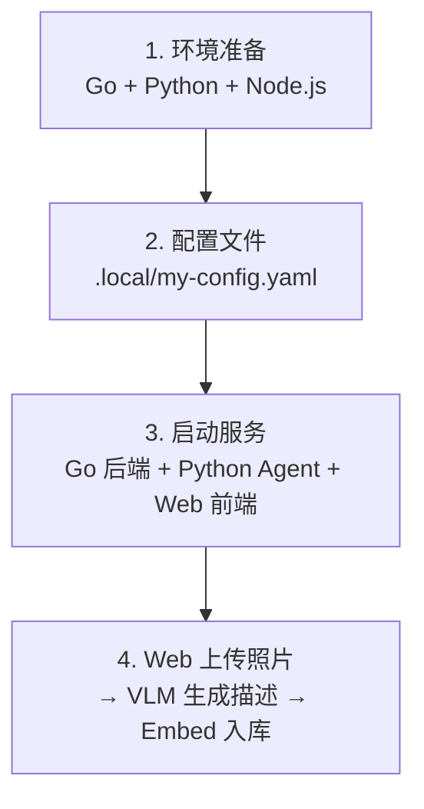

# Photo Agent — 部署指南

> 本文档描述在新环境中从零部署 Photo Agent 的最简流程。
> 部署完成后，通过 Web 前端（`http://localhost:10006`）使用全部功能。

---

## 部署全景



---

## 1. 环境准备

- **Go** ≥ 1.23
- **Python** 3.12（推荐用 `uv` 管理）
- **Node.js** + pnpm

```bash
cd /root/code/photo-agent

# 编译 Go 后端（产物: backend/bin/server）
cd backend && make build
cd ..

# Python 环境
cd agent
uv python install 3.12
uv venv .venv --python 3.12
source .venv/bin/activate
uv sync

# Web 前端
cd ../web
pnpm install
```

---

## 2. 配置文件

```bash
cp configs/config.yaml .local/my-config.yaml
```

编辑 `.local/my-config.yaml`，填写以下必填段：

```yaml
LLM:
  BaseURL: "https://api.openai.com/v1"
  APIKey: "sk-xxxxxxxx"
  Model: "gpt-4o-mini"

VLM:
  APIKey: "sk-xxxxxxxx"
  Model: "gpt-4o-mini"              # 需支持视觉能力
  BaseURL: "https://api.openai.com/v1"

Embedding:
  APIKey: "sk-xxxxxxxx"
  Model: "text-embedding-3-small"
  BaseURL: "https://api.openai.com/v1"

Storage:
  PhotoSrc: "./data/photos/src"        # 照片源目录
  PhotoPath: "./data/photos/compressed"  # 压缩后图片存储路径

Agent:
  Addr: "0.0.0.0:10005"
  # Agent Runtime 开放目标执行的预算（可选，缺省 12 步 / 300 秒 / 2 元）
  # RuntimeMaxSteps: 12
  # RuntimeTimeoutSeconds: 300
  # RuntimeCostLimit: 2.0

Web:
  Addr: "0.0.0.0:10006"
```

> Go、Python 和 Vite 开发服务器共用此配置文件。`Http`、`Sqlite` 暂为 pgo 兼容段；`Agent.Addr`、`Web.Addr` 分别控制 Agent 与 Web 的监听地址。连拍阈值不再写入 YAML，数据库无记录时使用后端代码默认，后续修改由 Web 设置页写入数据库。`Agent.Runtime*` 三个键控制对话中开放目标（选片 + 创作）多步执行的步数/时长/成本上限，缺省即用内置默认值。

---

## 3. 启动服务

三个进程，各占一个终端：

```bash
# 终端 1: Go 后端（:10004）
cd backend && ./bin/server -c ../.local/my-config.yaml

# 终端 2: Python Agent（:10005）
cd agent && source .venv/bin/activate
python cli/photo_agent.py -c ../.local/my-config.yaml --serve

# 终端 3: Web 前端（:10006）
cd web && pnpm dev
```

访问 `http://localhost:10006` 开始使用。通过 Web 前端上传照片，在详情页点击"生成描述"实时调用 VLM，再通过"Embed"按钮将描述嵌入向量库。

---

## 4. 验证清单

- [ ] `cd backend && make build` 编译通过
- [ ] `.local/my-config.yaml` 中 API Key 有效
- [ ] `cd backend && ./bin/server -c ../.local/my-config.yaml` 启动，`/api/v1/health` 返回 OK
- [ ] Python Agent `--serve` 启动，`/api/chat/health` 返回 `{"status":"ok"}`
- [ ] Web 前端 `pnpm dev` 正常启动，页面可访问
- [ ] 照片管理页可见已导入的照片
- [ ] AI 对话可正常问答

---

## Go 后端监控

### 1. 启用诊断端口

在 `.local/my-config.yaml` 中配置：

```yaml
Diagnostics:
  Enabled: true
  Addr: "0.0.0.0:19090"
  Pprof: false
```

在 `backend/` 下重新编译并重启 Go 后端。向监控网络开放诊断端口。

### 2. 添加 Prometheus job

将 [抓取配置](../configs/monitoring/prometheus.yml) 中的 job 合并到现有 `scrape_configs`，target 填写 Prometheus 可达的后端地址，保留 job 名 `photo-agent-backend`。

从 Prometheus 所在网络验证：

```bash
curl -fsS http://<target地址>/metrics
curl -fsS http://<target地址>/healthz
```

重载 Prometheus 配置，在 Targets 中确认 `photo-agent-backend` 为 `UP`。

### 3. 导入 Grafana dashboard

在 Grafana 的 Dashboards → New → Import 上传 [photo-agent-backend.json](../configs/monitoring/grafana/photo-agent-backend.json)，在顶部 `Prometheus` 下拉框选择数据源。

可按 Instance、Request operation、DB operation 筛选服务健康、请求、数据库、进程和 Go runtime 指标。

### 4. 确认数据

确认健康、连接池和 Go runtime 面板有数据。成功调用一次生成接口（如照片列表），等待至少两次抓取，确认请求面板出现对应 operation。

- **请求**：仅覆盖现有 Kratos 中间件处理并正常返回的调用；上传、图片读取等手动路由及 panic 恢复路径不保证计入。错误率按 Go `error` 分类。
- **数据库**：覆盖 pgo 默认连接的 GORM 操作与连接池。
- **无流量**：错误率和 P95 可无数据。
- **健康**：展示抓取与数据库依赖状态，不代表 Agent、VLM 或 Embedding 可用。

---

## 常见问题

### Q: 新增照片后如何处理？

通过 Web 前端上传照片，然后在图片管理页：
1. 点击照片详情页的"生成描述"实时调用 VLM
2. 或点击顶栏"VLM"按钮批量处理所有无描述照片
3. 处理完成后点击"Embed"按钮将描述嵌入向量库

### Q: 如何重建 ChromaDB 索引？

```bash
rm -rf ./data/agent/chroma/
# 然后通过 Web 界面或 CLI 重新执行批量 Embedding
```

### Q: 如何更换 LLM 供应商？

修改 `.local/my-config.yaml` 中 `LLM`、`VLM` 或 `Embedding` 段的 `BaseURL` 和 `Model`。项目通过 OpenAI 兼容 API 调用，支持火山引擎、通义千问、DeepSeek 等。

### Q: 端口冲突？

Go 后端监听 `Http.Addr`，Python Agent 监听 `Agent.Addr`，Web 前端监听 `Web.Addr`（模板默认分别为 `:10004`、`:10005`、`:10006`）。Python Agent 也可通过 `--serve <port>` 临时覆盖监听端口。

### Q: 会话数据存储在哪里？

`data/agent/sqlite/chat_sessions.db`（SQLite），可在配置文件中通过 `Agent.ChatDBPath` 调整。

## Windows 批次导入

在仓库根目录运行 `make client`，产物为 `bin/photo-agent.exe`。Windows 客户端的「设置」中填写可访问的 Go 后端地址。服务端启动时会自动创建批次核验与最近删除所需的数据表。

在客户端打开「导入工作流」，先选导入模式。

- 「电脑原片」选择本地照片目录，可附加 iPad 收藏目录为匹配的原片标记收藏。
- 「按 iPad 选片结果导入」选择筛选前的 JPG 范围和筛选后导出的留存目录。可附加收藏目录以继承收藏和补充独有 JPG，也可附加本地原片用于配对及核对废片。

两种模式都按去掉扩展名的文件名匹配 iPad 收藏。例如收藏目录中的 `DSC_0123.NEF` 可给同名 JPG 标记收藏。
本地原片和 iPad 收藏指向同一目录时，请移除重复目录或更换收藏目录后再开始选片。

填写服务器活动目录，再点「开始选片」。客户端扫描并上传 JPG，暂存于 `Storage.PhotoSrc/.import-review/<内部批次编号>/`。

服务器收到每张 JPG 后即准备预览和连拍特征，上传完成后自动计算分组，默认模糊合并。可在图片列表或预览弹窗中收藏和标记删除。

点「选片完成」后，客户端按需打开回收确认和入库预览。确认入库后，默认留存及收藏的 JPG 从服务器暂存区归档，客户端补传配对 NEF。确认回收已入库文件后，客户端自动清理本批次暂存。没有待处理文件的步骤自动跳过。

「继续已有批次」只显示可以继续导入的批次。废弃中途停止的批次时，点「清理批次」，勾选后确认废弃。服务器暂存清理失败时，在同一入口重试。

确认回收后，客户端在原片所在的各个目录归集文件并移入 Windows 回收站。需要还原时，在回收站还原对应的 `批次名-reject` 或 `批次名-keep` 目录。服务器回收项在「图片管理 → 最近删除」恢复，保留 30 天。

### 导入性能记录

客户端和 Go 后端更新后，用一批包含 JPG、配对 NEF 和废片的照片走完导入。提取日志里以 `import.trace` 标记的记录。

- Windows 客户端日志位于 `%APPDATA%\photo-agent\photo-agent.log`，可在 PowerShell 运行 `Select-String -Path "$env:APPDATA\photo-agent\photo-agent.log" -Pattern 'import\.trace'`。
- 使用 `make start` 启动的 Go 后端可运行 `rg 'import\.trace' logs/backend.log`。其他部署方式从 Go 服务日志提取相同记录。
- 从最近一次 `phase=scan` 的 JSON 记录取 `batch_id`，用它筛选两端日志。用 `request_id` 对照上传或归档 RPC 与服务端处理，用 `job_id` 对照客户端连拍等待和服务端计算。

`duration_ms` 是阶段总耗时，`spans` 记录细分动作的次数、累计时间及适用的字节数。子动作可嵌套，后台缩略图和特征计算可与上传重叠。客户端的 `request_written_ms` 从请求开始算起，包括连接和读取本地文件，服务端的 `stream_hash_write` 同时覆盖接收、哈希和写入。比较系统文件管理器操作时，记录文件数、总字节、源盘与目标和是否为重试，避免用不同条件的批次计算差距。

## 活动目录维护

每个拍摄活动对应 `Storage.PhotoSrc` 下的一个普通一级子目录。`.photo-agent.json` 保存活动 ID、时间和备注，备份或改名时一起保留，保持 `id` 不变。时间线页面可修改目录名、具体时间和备注；服务器直接改目录名后，下一次读取活动或照片会自动同步。正式上传未结束时先完成导入，再改名。

后端启动时自动迁移旧照片路径并同步活动。也可在停止后端和 Agent 后，从 `backend/` 单独执行，不启动服务：

```bash
go run ./cmd/activity-sync -c ../.local/my-config.yaml
```

迁移前保留 SQLite 和图片目录备份。当前照片 ID、收藏及 AI 处理结果沿用；旧根目录收藏的一次性打包、清理与恢复位置见[执行记录](_agents/2026-11-18-activity-directories.md)。
