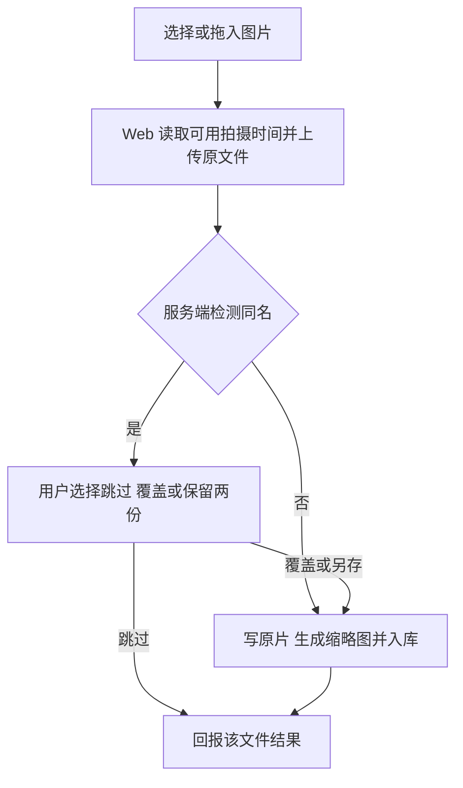

# Web 照片上传详细设计

- 状态 · 已确认
- 规划类型 · 资料驱动规划
- 需求来源 · [Web 照片上传规格](../product-specs/2026-06-18-web-photo-upload.md)
- 设计范围 · 原图上传、缩略图生成和同名处理

## 核心方案

- Web 顺序处理待上传文件。单个文件失败时记录错误并继续其余文件。
- Go 保存原片、生成缩略图并提取 EXIF。拍摄时间可由浏览器读取传入，也可由服务端从源文件提取。
- 覆盖沿用已有照片 ID 并更新缩略图、拍摄时间及属性。保留两份使用带后缀的文件名另建记录。新文件生成缩略图或入库失败时尝试清理本次产物。

## 补充说明 · 按需查阅

- 上传组件将浏览器原文件送到 Go，多部分表单承载文件名、可选拍摄时间与冲突决策。缩略图处理集中在服务端。 [Web 上传](../../web/src/composables/useUpload.ts) · [Go 上传](../../backend/internal/defaultService/service/svc_photo.go#L419)
- 同一上传接口服务桌面导入。NEF 路径只保存源文件；Web 选图按图片 MIME 类型接受文件。 [桌面导入设计](2026-08-11-desktop-import-design.md)
- 上传成功后的列表浏览与 AI 处理分别见 [分段浏览设计](2026-08-20-lb-photo-list-browsing-design.md) 和 [资产质量设计](2026-08-26-ai-asset-quality-design.md)。
- UP-A1 至 A3 以临时目录的上传测试和页面冲突分支核对。 [用户路径测试](../../backend/internal/defaultService/service/user_paths_test.go)
