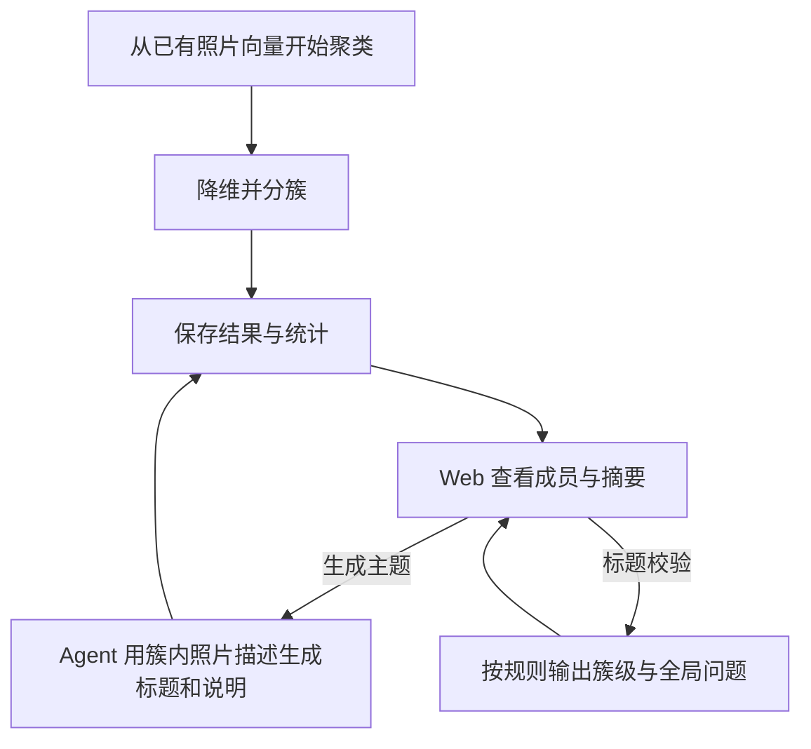

# 聚类结果审阅详细设计

- 状态 · 已确认
- 规划类型 · 资料驱动规划
- 需求来源 · [聚类结果审阅规格](../product-specs/2026-07-26-cluster-review.md)
- 设计范围 · 后台聚类、结果持久化、标题生成及评估

## 核心方案

- 照片向量在 Agent 聚类，任务异步执行。结果保存为 JSON，主题生成更新标题和说明。
- 标题校验读取 `cluster_theme` 规则。整份结果可执行跨簇规则，指定簇或单簇只执行局部规则。
- 启动接口只返回任务 ID。当前页面直接读取结果统计，可能提前提示失败，后台任务仍会保存结果。
- 「仅处理含错误」由 Web 选择批量目标。当前映射预填所有簇，通过项可能一起被处理，不能用按钮文案判断实际范围。

## 补充说明 · 按需查阅

- Agent 采用 UMAP 和 HDBSCAN，返回簇及噪声统计。聚类接口通过任务 ID 提供运行状态。 [聚类实现](../../agent/internal/topics/cluster.py) · [任务入口](../../agent/cli/server.py#L1235)
- 单簇生成、批量生成与评估为不同操作。评估报告保留在评估记录中，打开详情时前端重置当前报告视图。 [Web 聚类页](../../web/src/views/ClusterView.vue) · [评估入口](../../agent/cli/server.py#L2343)
- CLUSTER-A1 至 A3 核对页面、任务状态与服务边界。真实主题标题和界面操作需用隔离样本复验。 [评估规则](../../configs/evaluation.yaml)
