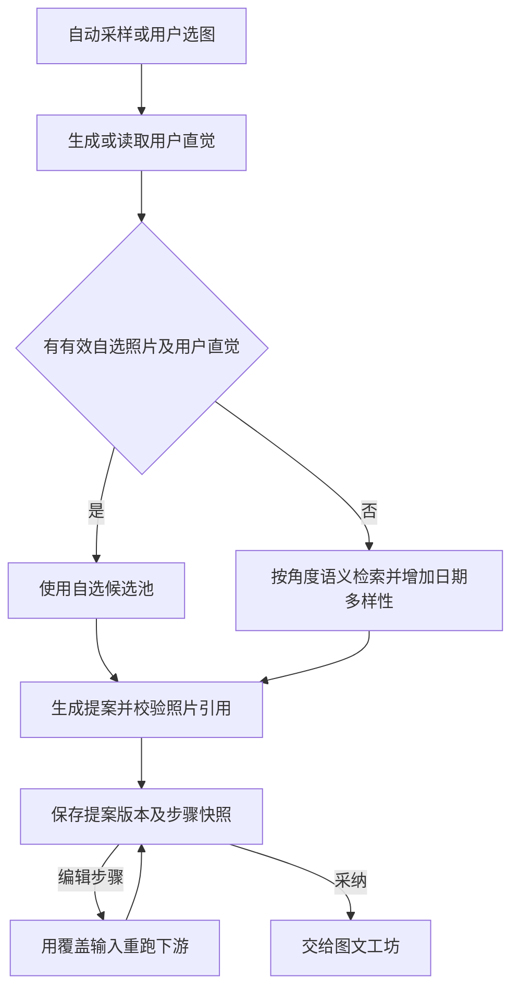

# 主题发现详细设计

- 状态 · 已确认
- 规划类型 · 资料驱动规划
- 需求来源 · [主题发现产品规格](../product-specs/2026-08-01-topic-discovery.md)
- 设计范围 · 编辑视角管线、版本回放与工坊交接

## 核心方案

- 角度与照片分两步确定。采样阶段用画面描述寻找叙事连接，日期参与扩展后的多样性筛选及提案表达。
- 提案校验使用候选池内的图库 ID。短跨度记录诊断；日期多样性过滤可在候选不足时补入照片。
- 一条历史记录维护其版本链。重跑生成新版本，切换版本更新当前提案。评分独立保存在历史记录。

## 补充说明 · 按需查阅

- Agent 读取 Go 照片数据。扩展选片使用全量照片向量集合。聊天 Runtime 另有支持范围约束的主题发现入口。 [提案管线](../../agent/internal/topics/suggest.py) · [范围化工作流](../../agent/internal/runtime/capabilities/workflows.py)
- API 持久化 JSON 历史、当前版本和步骤快照。详情优先使用已存步骤，缺少快照时尝试按 Trace 补齐。重跑接口提供阶段进度。 [服务入口](../../agent/cli/server.py#L1493) · [详情与重跑](../../web/src/composables/useSuggestDetail.ts)
- Web 复用通用选图，将图库 UUID 交给主题管线。采纳时将提案转为工坊输入。 [选图设计](2026-08-26-photo-selection-design.md) · [图文工坊设计](2026-08-23-post-studio-feature-design.md)
- TOPIC-A1 至 A3 以管线分支、历史 API 和页面入口核对。真实提案质量和版本交互证据见历史评估。 [评估基线](../eval/baseline.md#管道正确性基线)
