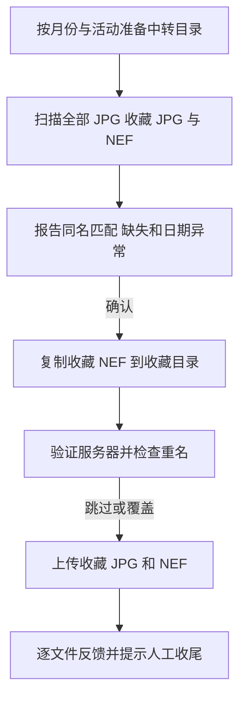

# W1–W12 桌面导入详细设计

- 状态 · 已确认
- 规划类型 · 资料驱动规划
- 需求来源 · [桌面导入产品规格](../product-specs/2026-08-11-desktop-import.md) · [W1–W11 交付记录](../version/v1.0.9.md)
- 设计范围 · 已上线的三步导入、客户端文件操作和服务端同步

## 核心方案

- 文件边界 · 匹配依据是去扩展名的文件名。中转目录原件保留，收藏 NEF 采用复制。服务器只接收收藏目录中的 JPG 和 NEF。
- 入库边界 · JPG 生成缩略图并进入照片管理。NEF 只写原片目录。同名 JPG 的 NEF 标记由服务端按相邻源文件推导。
- 失败处理 · 单文件失败自动重试一次，持续失败列入结果。跳过重名可用于补传。客户端保留原始文件修改时间，拍摄时间另行传递。

## 补充说明 · 按需查阅

- Wails 嵌入 Web 页面，前端负责编排三步和进度。Go 客户端负责选择路径、扫描、复制与 HTTP 上传。中转根目录按 `full/like/nef` 分开，各自包含 `YYYYMM` 或 `YYYYMM-活动名` 子目录。 [导入页面](../../web/src/views/ImportWorkflow.vue) · [本地操作](../../client/import.go)
- 服务端状态检查扫描照片原片存储根目录。客户端在上传前读取重名集合，使用有限并发上传，进度按文件回报。服务端按照片上传契约入库。 [同步实现](../../client/sync.go) · [存储接口](system-design.md#41-go-backend-apiapiv1)
- 清理建议以本次归档目录为单位。跳过项计入同步结果，仍需人工核对同名文件和未上传的留存 NEF。
- W-A1、A2 可用客户端临时目录和本地模拟 HTTP 测试核对。Windows 界面及实际归档验证见版本记录。 [文件操作测试](../../client/import_test.go) · [同步测试](../../client/sync_test.go) · [历史验证](../version/v1.0.9.md)
- AutoCull 与相机、iPad 汇合入库的演进方案由 W14 单独维护。 [W14 设计](2026-11-13-1-autocull-import-design.md)
