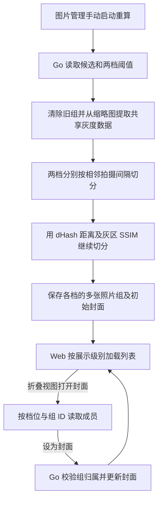

# BG1 连拍分组详细设计

- 状态 · 已确认
- 规划类型 · 资料驱动规划
- 需求来源 · [连拍分组产品规格](../product-specs/2026-08-19-burst-grouping.md) · [BG1 交付记录](../version/v1.0.10.md#连拍分组bg1)
- 设计范围 · 连拍识别、双档位重算、列表展示和封面维护

## 核心方案

- 识别 · 时间窗限制相邻拍摄间隔，视觉相似度在窗口内排除构图突变。灰度缺失时该相邻对沿用时间窗结果。Go 复用 ImageMagick 和已有缩略图，分组无需模型。
- 重算 · 后端单进程内串行，先清旧组，再逐档写回，手选封面随之重置。写库失败可能留下部分结果，前端仍可能提示完成，原因见后端日志。
- 展示 · 折叠时只渲染封面与未分组照片。组内弹窗单独取数，最多 100 张。设封面只更新指定组，另一档独立维护。

## 补充说明 · 按需查阅

### 识别与阈值

- 候选按拍摄时间、导入时间升序读取，排除 NEF 和 `shot_at` 不晚于 `2000-01-01T00:00:00Z` 的记录。时间窗比较相邻照片，因此组的总跨度可超过单次时间窗。 [候选查询](../../backend/internal/defaultService/data/dao_photo_group.go)
- ImageMagick `convert` 生成 `9×8` 灰度矩阵，Go 用同一矩阵计算 64 位 dHash 和 SSIM。距离不超过灰区下界时按哈希阈值判断，落在下界以上至上界时用 SSIM，超过上界即切分。 [识别实现](../../backend/internal/defaultService/service/svc_burst_group.go#L446)
- 两档阈值保存在 `app_settings` 的 `burst_config`，无记录时读代码默认值。启动时读取配置快照，保存设置影响下一次重算。 [默认值与校验](../../backend/internal/defaultService/service/svc_burst_group.go#L53)

### 存储与浏览契约

- `photo_groups` 按档位独立保存组身份、封面、数量和时间跨度。`photos` 两列分别保存精细、模糊组引用，由服务层维护逻辑关联。独立组记录使更换封面只需修改一处。 [组表](../../backend/sql/photo_groups.sql) · [组服务](../../backend/internal/defaultService/service/svc_burst_group.go#L293)
- 照片搜索默认用精细档，`burst_profile=coarse` 时切换组过滤列和返回的组字段。封面标记与数量由服务按组记录补充。组内取数独立于当前列表筛选和窗口。分段定位按 [LB 详细设计](2026-08-20-lb-photo-list-browsing-design.md)处理。 [照片搜索](../../backend/internal/defaultService/service/svc_photo.go#L148) · [成员取数](../../web/src/composables/usePhotos.ts#L482)
- 状态接口返回运行标志、进度与组数。图片管理的完成回调刷新列表并请求 Agent 同步组向量。同步复用已有照片向量，失败单独提示。 [连拍 API](system-design.md#41-go-backend-apiapiv1) · [图片管理](../../web/src/views/PhotoManagement.vue#L203) · [向量同步](../../agent/infra/embed_queue.py#L389)

### 验证依据

- BG-A1、A4 · Go 单测覆盖时间窗、相似度切分、灰区判定、双档位和阈值校验。重复启动与失败状态以服务代码核对。 [算法测试](../../backend/internal/defaultService/service/svc_burst_group_test.go)
- BG-A2、A3、A5 · 用隔离样本核对三级切换、封面重置和弹窗边界。真实库识别效果与重算耗时属于 BG1 P5 实机验收。 [v1.0.10 验证与遗留验证](../version/v1.0.10.md#验证与遗留验证)
