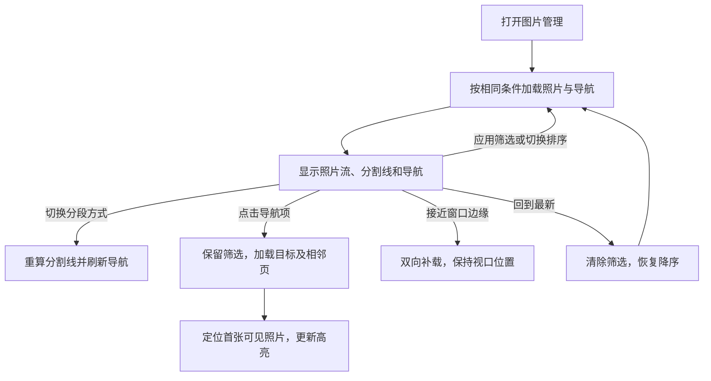

# LB 图片管理分段浏览详细设计

- 状态 · 已确认
- 规划类型 · 资料驱动规划
- 需求来源 · [图片管理分段浏览产品规格](../product-specs/2026-08-20-photo-list-browsing.md)、[v1.0.10 列表浏览与导航](../version/v1.0.10.md#列表浏览与导航lb1-lb4)
- 设计范围 · 图片管理的筛选、分段导航与双向滚动

## 核心方案

### 筛选与定位

- 列表按拍摄时间升降序。按天、按月共用月份导航，按活动使用活动导航。
- 列表独立滚动，顶栏和右侧导航留在各自区域。
- 时间线提供活动和散片标签。连拍折叠改变可见照片卡，导航计数仍按匹配照片计算。

### 已知实现差异

- 日期筛选要求即时刷新。当前日期输入只更新条件，需其他操作触发查询。
- 本地月份分割线与后端 UTC 月份导航可能跨月错位，影响计数和落点。
- 连拍封面在目标段外时，当前窗口可能没有可见锚点，跳转会落到窗口顶部。折叠场景待复验。 [源码核对](../_agents/2026-11-14-photo-list-browsing.md#规格与实现差异)

## 补充说明 · 按需查阅

### 查询与显示

- 查询口径 · 列表与导航共享筛选和排序。文件名搜索使用后端关键词匹配，覆盖文件名和照片描述。原始 NEF 由资产流程管理。
- 导航契约 · 返回分段标识、名称、匹配照片数和首现位置。后端扫描当前结果的分段字段，位置按折叠前的照片序列计算。 [照片服务协议](../../backend/proto/photo_service.proto) · [共享查询](../../backend/internal/defaultService/data/dao_photo.go)
- 活动标签交错时，每段各有分割线，导航按活动合并。空活动标签归「未分类」，导航排末位，照片流保持时间顺序。
- 缺失拍摄时间的照片保留列表位置，日期模式显示「未知时间」，服务端跳过其导航分组。
- 分割线计数取已加载的可见照片卡。高亮按分割线相对列表视口的位置更新。 [分段计算](../../web/src/utils/segment.ts) · [导航与滚动](../../web/src/components/PhotoListBrowser.vue)
- 顶栏 · 「更多」收纳搜索、筛选和统计，空间不足时也收纳总数和视图控制。 [顶栏](../../web/src/components/PhotoManagementToolbar.vue)
- 照片卡 · 元数据气泡延迟显示，滚轮仍作用于列表。 [照片卡](../../web/src/components/PhotoCard.vue)
- 滚动容器 · 页面依赖布局组件的内部容器传递高度，组件库升级时复验照片列表独立滚动和自动续载。 [页面布局](../../web/src/views/PhotoManagement.vue#L305)

### 加载与失败反馈

- 初始加载及导航跳转取目标页和可用的前后页。窗口超限时从反向整页淘汰，以已有照片卡补偿滚动。
- 连拍折叠后首屏未填满时，渲染后复查并补载。加载标记和在途同页去重控制重复请求。
- 上传或删除后刷新导航计数与位置。主请求失败显示错误和重试，辅助请求失败单独提示。 [列表数据](../../web/src/composables/usePhotos.ts) · [照片网格](../../web/src/components/PhotoGrid.vue) · [页面编排](../../web/src/views/PhotoManagement.vue)

### 设计取舍

- 窗口重定位保留相邻结果，代价是客户端需管理双向边界、加载状态和滚动补偿。
- 按天使用月份导航，控制导航项数量。日期细分由分割线提供，拍摄时间排序保证浏览顺序。 [排序决策](../note.md#15-照片列表排序收敛三键排序--仅拍摄时间升降序2026-08-20)
- 活动选项读取照片库的活动目录，另保留「未分类」入口。 [活动目录设计](system-design.md#37-活动目录与时间线同步)

### 验证依据

- LB-A2、A3、A4、A7 · 用跨月、交错活动、多页和含连拍组的隔离样本。应用跨段筛选，跳至窗口外的目标，再双向滚动。核对筛选、落点、高亮及相邻照片顺序。
- LB-A1、A5 · 核对本地日月分割线、服务端计数和位置。浏览器复验月初凌晨照片的导航与高亮。 [前端用例](../../web/src/utils/segment.spec.ts) · [后端用例](../../backend/internal/defaultService/data/dao_photo_test.go)
- LB-A6 · 分别模拟空结果、照片请求失败和导航请求失败，核对页面反馈与列表重试。
- LB-A7 · 历史评估样本为 1323 张，2000+ 张滚动场景待复验。记录样本量、展示级别和滚动结果。 [历史评估](../eval/reports/2026-08-21-photo-list-lb-series.md)
