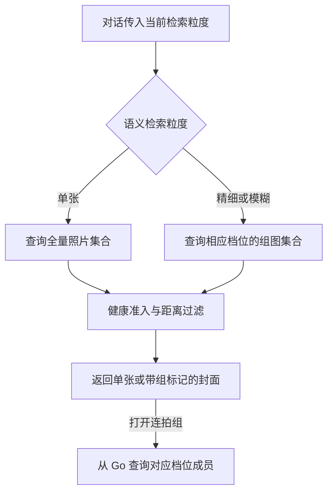

# GR1 组图检索详细设计

- 状态 · 已确认
- 规划类型 · 资料驱动规划
- 需求来源 · [组图检索产品规格](../product-specs/2026-08-22-grouped-retrieval.md) · [GR1 交付记录](../version/v1.0.12.md#组图检索与质量评估闭环)
- 设计范围 · 检索粒度、向量集合与组图展示

## 核心方案

- 索引单位 · 两个组图集合分别保留各档组封面与组外单张。同组成员依然可从全量集合命中。
- 同步 · 组结构以 Go 为准。图片管理重算结束后请求同步组图集合，复用全量集合已有向量。封面尚无向量时，待该照片完成嵌入。
- 数据边界 · Chroma 保存语义向量及关联、版本、组图展示元数据。结构化属性由 Go 维护，结构化过滤在 SQL 或 Runtime 范围约束中处理。

## 补充说明 · 按需查阅

- 选集 · Web 随消息传入 `photo`、`fine` 或 `coarse`，Agent 根据粒度选择集合。组结果带组 ID 与数量，成员查询根据组 ID 前缀选择档位。 [语义检索](../../agent/internal/chat/photo_rag.py) · [对话页面](../../web/src/views/ChatView.vue)
- 更新 · 同步按现行组结构清除失效组并刷新封面、组外单张及增量写入路由。单独换封面写 Go 组记录，图片管理的该操作没有立即调用组向量同步。 [索引同步](../../agent/infra/embed_queue.py#L389) · [封面更新](../../web/src/composables/usePhotos.ts#L525)
- 准入 · 检索候选需有健康描述。有版本的向量须匹配当前描述，旧版无版本记录按兼容路径读取。组合查询的结构化过滤与 RAG 候选按照片 ID 相交。 [系统设计](system-design.md#33-combined-组合查询详解) · [健康过滤](../../agent/internal/chat/photo_rag.py#L263)
- 验证 · GR-A1、A3 可用组集合写入单测及评估种子用例，GR-A2 用浏览器核对会话恢复。 [评估用例逻辑](../eval/eval-test-logic.md)
