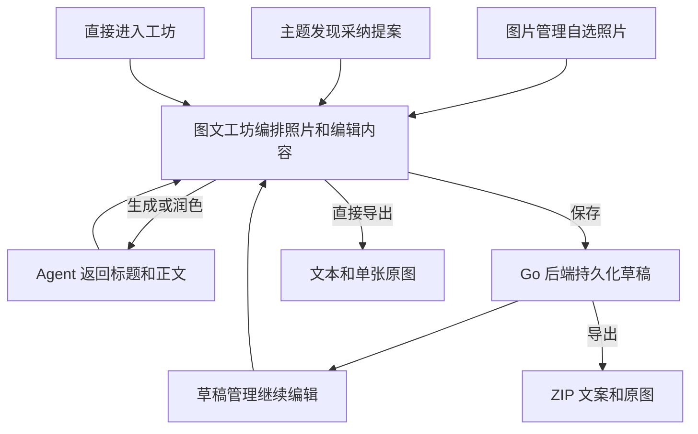

# PS 图文工坊详细设计

- 状态 · 已确认
- 规划类型 · 资料驱动规划
- 需求来源 · [图文工坊产品规格](../product-specs/2026-08-23-post-studio.md) · [PS1–PS6 交付记录](../version/v1.0.11.md#图文工坊ps1-ps6)
- 设计范围 · 创作入口、照片上下文、文案契约、草稿与导出

## 核心方案

- 照片顺序 · 编排顺序进入生成请求，连拍组按成员展开。已保存草稿保留组引用，重开时读取组成员。
- 事实边界 · 生成依据照片摘要与用户要求。润色以初稿为事实边界，配图辅助表达。部分缺描述时提示，全部缺描述时拒绝带图生成或润色。
- 保存与导出 · 草稿保存模式和两份输入。文本与单张原图来自当前编辑内容，ZIP 读取已保存草稿，未精选的连拍组取封面。

## 补充说明 · 按需查阅

### 页面与数据职责

- Web 汇合自选、提案和草稿入口。采纳提案优先使用提案照片序列，叙事内容预填正文及润色输入。Agent 候选过多时也可传入照片进入工坊。 [工坊页面](../../web/src/views/PostStudio.vue) · [主题采纳](../../web/src/views/SuggestView.vue) · [Agent 候选入口](../../agent/internal/runtime/capabilities/creation.py)
- 工坊复用照片卡、详情灯箱与连拍精选弹窗，补图搜索由工坊维护。详情按当前照片顺序切换。详情处理入口与元数据编辑边界见 [FR-7](../future-requirements.md#fr-7-详情面板读写模式区分)。
- Go 草稿服务保存照片顺序与组引用、文案、来源、风格和两种模式输入。状态由草稿管理手动修改。空标题和正文沿用原值，两份模式输入支持清空。 [草稿服务](../../backend/internal/defaultService/service/svc_draft.go) · [PS10 验收记录](../version/v1.0.15.md#验证结果) · [FR-8](../future-requirements.md#fr-8-草稿字段清空能力)
- ZIP 在打包前检查原片是否可用，并为同名照片分配文件名。接口与路由见 [系统设计](system-design.md#41-go-backend-apiapiv1)。

### 文案上下文与结果

- Agent 按请求顺序通过 Go SDK 读取照片详情。VLM 描述提取主体、场景、光线和概述，纯文本旧描述截取后使用。攻略在完整摘要中附可用 EXIF，超过 20 张有描述照片时采用简要摘要。 [文案实现](../../agent/internal/posts/post_studio.py)
- 系统消息承载角色、写作约束及风格。用户消息承载有序照片摘要、拍摄日期或跨度，以及本次要求或待润色的初稿。内置风格统一映射，自定义风格直接传入。
- 结果使用标题、正文和可选警告。服务端可解析带围栏的 JSON，并修复有限的尾括号缺失。格式无法解析时返回错误，前端保留已有文案。 [服务入口](../../agent/cli/server.py#L2518)
- 文字摘要复用照片库的 VLM 数据，避免再次分析原图。事实约束和风格由提示词表达，文案效果通过样本验收。

### 验证依据

- PS-A1、A4、A5 · 用隔离照片和草稿核对入口、保存恢复及 ZIP 内容。草稿响应单测覆盖模式和输入字段。 [Go 单测](../../backend/internal/defaultService/service/svc_draft_test.go)
- PS-A2、A3 · 用现有离线测试核对摘要、攻略 EXIF、缺描述和结果解析。浏览器场景需验证用户看到的反馈。 [Python 测试](../../agent/internal/posts/test_post_studio_smoke.py)
- 历史评估已有画面和 EXIF 的实际生成证据。拖拽对叙事的影响、四种风格差异、润色事实边界及浏览器完整导出仍待场景复验。 [PS1–PS6 评估](../eval/reports/2026-08-25-post-studio-ps-series.md)
