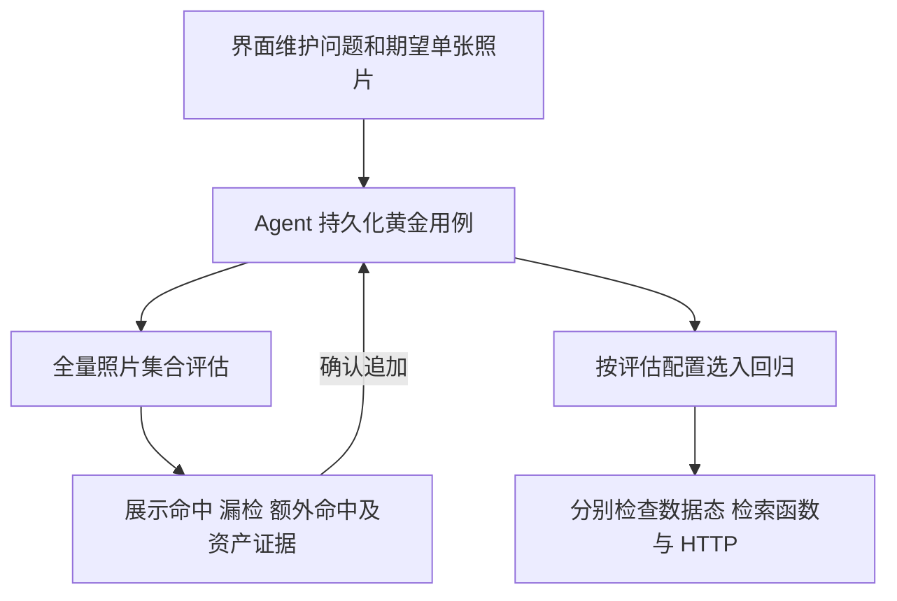

# TF1 黄金用例与检索回归详细设计

- 状态 · 已确认
- 规划类型 · 资料驱动规划
- 需求来源 · [检索黄金用例规格](../product-specs/2026-08-25-golden-query.md)
- 设计范围 · 用例契约、评估快照和分层回归

## 核心方案

- 黄金用例的期望为单张照片。组粒度选择服务于界面编排，回归的粒度断言由开发配置独立维护。
- 评估使用全量照片集合。指标基于匹配后的照片结果，并随结果保存当前资产健康证据。
- 回归按 L0 数据态、L1 检索、L2 HTTP 划分。配置了对话断言的 L2 用例会发真实聊天请求，且执行后清理临时会话。

## 补充说明 · 按需查阅

- 新建保存时展开未精选的组卡。服务端兼容旧照片列表与粒度字段，按单张引用读取和维护 JSON。更新整份照片集合与追加选定照片是不同操作。 [选图设计](2026-08-26-photo-selection-design.md) · [黄金用例服务](../../agent/cli/server.py#L1023)
- 匹配将检索 UUID 映射为去后缀文件名。资产快照保留描述和向量版本，便于定位期望照片失效。 [评估实现](../../agent/internal/evals/evaluation.py)
- TF-A1、A2 可用前端数据转换及服务单测核对。TF-A3 的层级、配置与命令见测试逻辑。带真实聊天断言的 L2 需当轮授权。 [测试逻辑](../eval/eval-test-logic.md)
