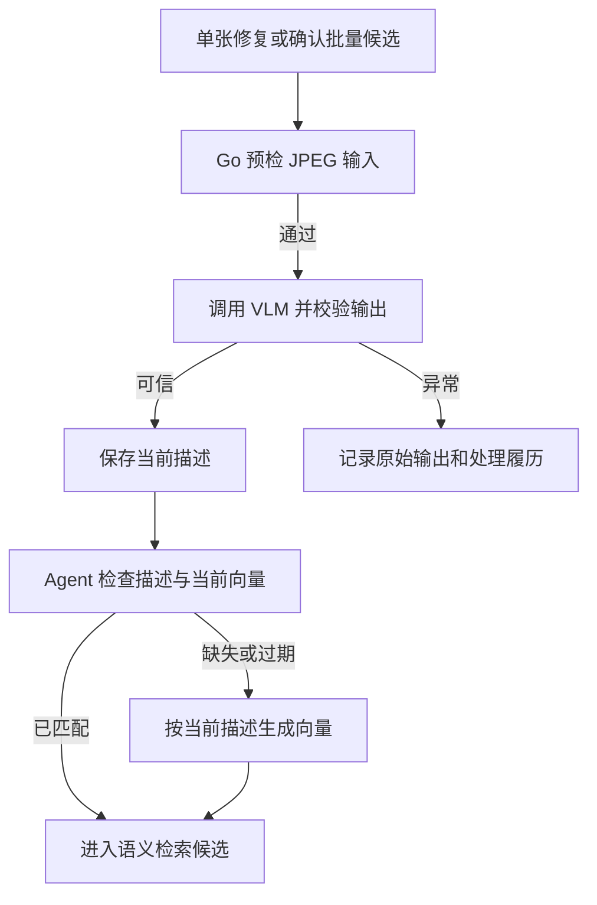

# AQL AI 照片资产质量详细设计

- 状态 · 已确认
- 规划类型 · 资料驱动规划
- 需求来源 · [AI 照片资产质量产品规格](../product-specs/2026-08-26-ai-asset-quality.md)
- 设计范围 · VLM 闸门、实时状态、Embedding 和检索保护

## 核心方案

- 状态归属 · Go 以当前描述推导 VLM 质量，Agent 以 Chroma 的实际向量与描述版本推导向量状态。界面叠加队列进度。处理履历供追溯。
- 保护 · 异常输出保留原始响应，当前描述与结构化属性沿用之前的值。检索核对当前描述与版本。无版本旧向量仍走兼容路径。
- 操作边界 · 审查和重新校验只执行本地检查。单张修复及批量确认复用既有队列。VLM 与 Embedding 各自维护候选。

## 补充说明 · 按需查阅

- 输入闸门验证 JPEG 头与尺寸，超限请求使用独立临时压缩文件。输出校验包含结构化 JSON、`image_integrity` 及已证实坏图措辞。 [输入预检](../../backend/internal/defaultService/service/vlm_compress.go) · [输出校验](../../backend/internal/defaultService/service/ai_quality.go)
- Go 批量 VLM 默认处理缺描述，强制批次还纳入当前描述待复核的照片。异常输出记录在原始描述和履历中，避免覆盖已发布描述。 [VLM 服务](../../backend/internal/defaultService/service/svc_vlm.go) · [实时审查](../../backend/internal/defaultService/service/svc_photo.go)
- Agent 向量写入记录描述摘要版本，缺失和过期项可进入重建队列。RAG 依据当前照片描述质量和向量版本过滤，黄金评估保留期望资产健康及版本证据。 [Embedding](../../agent/infra/embed_queue.py) · [检索准入](../../agent/internal/chat/photo_rag.py#L263) · [评估](../../agent/internal/evals/evaluation.py)
- AQL-A1 至 A3 用 Go 质量规则和 Agent 隔离测试核对。浏览器表现及真实坏图样本沿用版本验证入口。 [v1.0.13 验证](../version/v1.0.13.md#验证结果)
