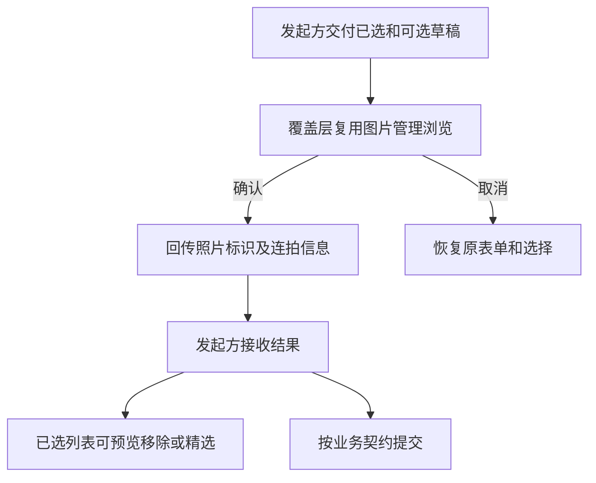

# 照片选择与已选展示详细设计

- 状态 · 已确认
- 规划类型 · 资料驱动规划
- 需求来源 · [照片选择产品规格](../product-specs/2026-08-26-photo-selection.md)
- 设计范围 · 通用选图、会话交接与已选区编辑

## 核心方案

- 覆盖层负责浏览与勾选。黄金用例和主题发现各自决定草稿恢复、随机抽样及提交格式。
- 新勾选的折叠组封面采用当前精细或模糊档。可识别的预选条目沿用已传入的粒度。
- 已选列表以组 ID 和粒度加载成员。精选只改变发起方持有的选择，原连拍组仍由图片管理维护。

## 补充说明 · 按需查阅

### 会话协议

- 每个浏览器标签页以 `sessionStorage` 保存一个选图会话。发起方写入来源、原选择及可选草稿，确认时覆盖层写回选择并设置完成标记，发起方消费后清理。黄金用例新建按来源恢复。 [会话存储](../../web/src/utils/photoPickSession.ts) · [黄金用例页面](../../web/src/views/GoldenQueryManagement.vue)
- 覆盖层按图库 UUID 勾选，回传 UUID、去后缀文件名和可选组标记。回传按去后缀文件名去重。确认时，新勾选条目从当前加载窗口解析，已被淘汰的条目可能缺失。预填时识别出的窗口外旧选择可随结果带回。 [覆盖层](../../web/src/components/PhotoPickOverlay.vue)
- 已选列表复用照片卡和连拍弹窗，组内最多请求 100 张。精选按成员列表顺序替换组卡，提交仍由调用方负责。 [已选列表](../../web/src/components/SelectedPhotoList.vue) · [主题发现适配](../../web/src/components/SuggestPhotoPicker.vue)

### 验证依据

- PICK-A1 至 A3 按黄金用例新建、主题发现手动选题和步骤编辑验收。历史版本记录保留打开、取消及草稿恢复的浏览器证据。 [v1.0.12 验证](../version/v1.0.12.md#验证与遗留验证)
