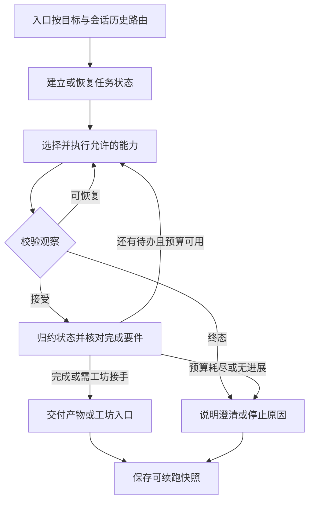

# AR Agent 多步任务详细设计

- 状态 · 已确认
- 规划类型 · 资料驱动规划
- 需求来源 · [对话多步任务规格](../product-specs/2026-08-28-agent-tasks.md) · [能力系统交付](../version/v1.0.18.md)
- 设计范围 · 目标准入、运行循环、权威范围与多轮续跑

## 核心方案

- 准入 · 已注册目标决定可用能力、观察类型及完成要件。单步查询沿用直接路由，未知开放目标显式返回说明。
- 范围 · 硬约束由程序物化为照片 ID 集。软提示只影响范围内排序；语义零命中可回到已确认范围。明确空范围直接停止。
- 续跑 · 跟进只作废受影响的产物。补选保留集不能单独满足选片要件，选片能力需实际续跑。候选超限可交接工坊。

## 补充说明 · 按需查阅

- 入口构建有界历史，消解跟进后给出目标与受影响部分。任务快照按会话存储，范围、选片、文案或其他产物按依赖局部失效。 [路由](../../agent/cli/photo_agent.py) · [状态](../../agent/internal/runtime/state.py) · [会话存储](../../agent/internal/chat/session_store.py)
- LangGraph 编排决定、执行、护栏、归约与检查。业务状态、能力契约和确定性完成检查保持独立。护栏按错误状态执行有界重试、修复、再决策或停止。时长、步数、费用和恢复各有预算。 [循环](../../agent/internal/runtime/graph.py) · [护栏](../../agent/internal/runtime/guardrail.py) · [完成检查](../../agent/internal/runtime/completion.py)
- 旅行日与时段按本地时间物化。活动起始日与首个拍摄日推算结果不一致时，请用户确认日期。候选及入选受范围约束。创作复用连拍折叠、两级收缩及工坊深链，承接 CQ4 的交付能力。 [范围解析](../../agent/internal/runtime/capabilities/resolve_trip.py) · [创作能力](../../agent/internal/runtime/capabilities/creation.py)
- 请求用 `trace_id` 关联入口决策、步骤、恢复、技术终态和用量。回放保留 30 天，用户反馈独立于技术终态。 [请求入口](../../agent/cli/server.py) · [回放](../../agent/internal/evals/trace_replay.py)
- AR-A1 至 A4 以状态、契约、跟进与故障注入测试核对。历史真实对话的证据随版本保留。 [故障注入](../../agent/tests/test_runtime_fault_injection.py) · [v1.0.19 验证](../version/v1.0.19.md#验证结果) · [架构演进](architecture/00-photo-agent-architecture.md)
