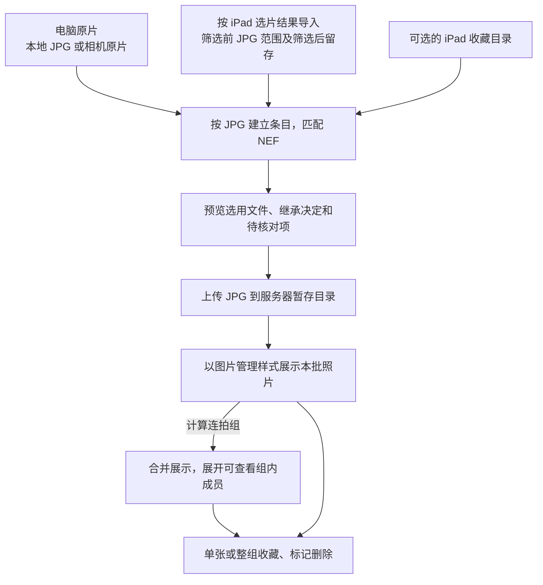
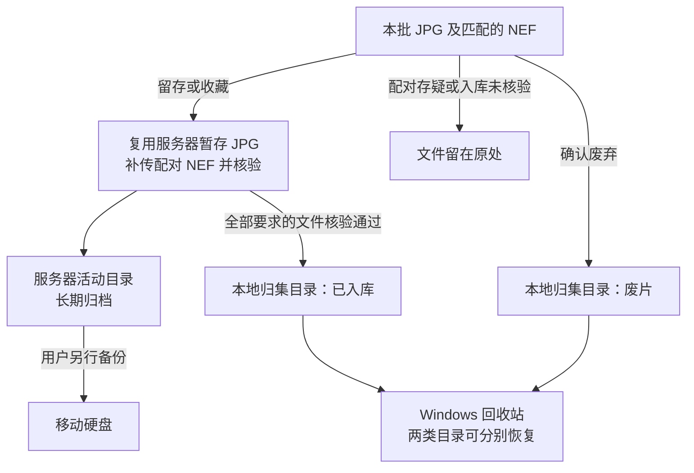
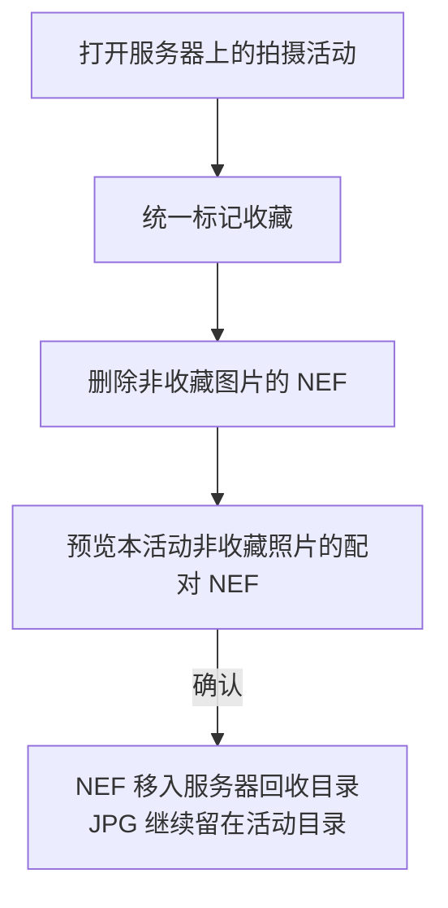
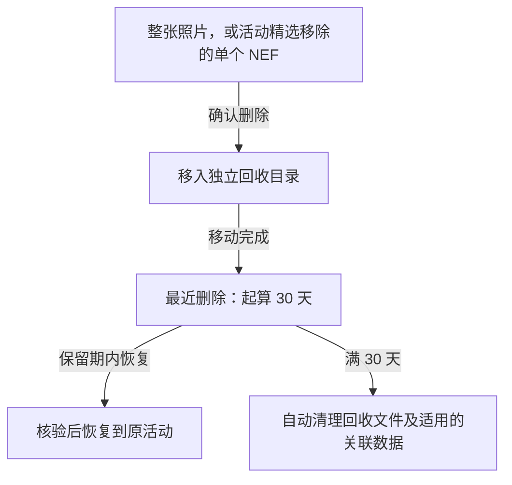

# W14 相机与 iPad 筛片入库详细设计

- 状态：分步导入和手动连拍选片方案已确认
- 规划类型：简述需求规划
- 需求来源：用户对话
- 设计范围：Windows 导入、连拍分组与手动选片、原片归档、活动精选与删除恢复

[现行桌面导入设计](2026-08-11-desktop-import-design.md) · [W14 实施入口](../backlog.md#w14-相机与-ipad-筛片结果汇合入库)

## 核心方案

### 1. 一个活动，一个导入页



- 「电脑原片」可选相机或手机目录，附加的 iPad 收藏只给匹配的本地照片加收藏标记。
- 「按 iPad 选片结果导入」必选筛选前的 JPG 范围与筛选后的留存目录。附加的收藏目录可补充选片照片并继承收藏，重复出现的 JPG 合成一条。可附加电脑原片，以相机 JPG 优先，或用 iPad 导出匹配本地 NEF。
- 确认留存目录是完整导出后，完整导出缺席可在「需核对」查看，仍由用户决定是否删除。批次保存导入模式和来源，继续已有批次时沿用原来的规则。
- 照片默认留存。单张和整组可收藏或标记删除，整组操作覆盖当前仍在组内的全部照片。可撤销上一次决定。确认回收后才处理本地原片。

### 2. 入库与本地回收



- 「开始选片」串起扫描、上传和连拍分组。选片完成和入库核验后，若有待回收文件，直接打开回收确认。空回收和空入库自动跳过。重新打开批次从已保存的步骤继续。
- 入库展示待入库照片的缩略图，可点开原图。单张出现归档异常时，在对应照片旁提示原因。
- 活动目录留空时采用所选本地来源的末级目录名。批次名默认取服务器活动目录，同名批次从 `-1` 开始编号。
- 回收时先确认归集位置，默认填入本次待回收的首个原片目录。在所选位置建立 `批次名-reject` 或 `批次名-keep`，归集后整目录进入 Windows 回收站。通过 Windows 回收站还原该目录。回收失败时可重试，核对原片仍在原处后可继续。
- 本地原片处理结束后，系统自动清理该批次的服务器暂存 JPG、预览和连拍计算数据，保留正式入库文件、批次信息和回收记录。清理失败时停留当前步骤，可重试。完成后可跳转图片管理并筛选该活动的全部照片，或开始新批次。

### 3. 活动精选与 NEF 清理



- 按活动处理，覆盖该活动的全部非收藏照片。所有 JPG 和收藏照片的 NEF 保留。
- 单独移除的 NEF 在「最近删除」中显示为「仅 NEF」，可重新关联原 JPG。

### 4. 服务器最近删除



- 整张照片删除时，JPG 和仍配对的 NEF 一起回收，照片退出日常浏览和检索。单独移除 NEF 时，JPG 继续可用。
- 回收目录位于活动目录之外，用户可按活动目录备份当前归档。

### 选片决定

JPG 先上传到服务器。连拍分组复用图片管理的拍摄间隔、dHash 和 SSIM 规则，限定在当前批次。照片按默认留存、收藏或标记删除进入后续流程。

## 补充说明 · 按需查阅

### 来源匹配与复审

- 目录选择支持电脑、SD 卡及子目录。已有 `full`、`like`、`nef` 目录可分别加入留存、收藏和本地来源。
- 匹配顺序
  - JPG 先核对内容，改名或重编码后用原名、拍摄时间及可用的相机信息核对。
  - 同目录同名优先匹配 NEF。分目录时结合拍摄范围、原名和拍摄信息。跨卡重名、多候选或证据冲突时进入「需核对」。
  - 预览显示实际文件路径、决定来源及「已配对」「仅 JPG」「需核对」。只传递审阅决定的 iPad 导出留在原位。
  - 单独的 NEF 补齐 JPG 后才能进入选片。扫描失败显示目录和原因，文件路径或盘符变动后核对内容再沿用决定。
- 审阅决定
  - 推导废弃时核对完整留存导出，并检查收藏导出中是否有匹配。覆盖未知、疑似漏匹配或收藏冲突的文件留在原处。
  - 重复导入沿用当前决定。新结果与已有人工决定冲突时逐项确认。
- 连拍与手动选片
  - JPG 暂存成功后立即准备预览和连拍特征，和后续上传并行。上传结束后自动计算精细和模糊两档连拍组，默认模糊合并。缺拍摄时间或无法读取的照片独立显示。
  - 单张和连拍共用大图预览，先显示缩略图。点击左右区域或用方向键换图，`Delete` 标记删除，`L` 收藏。连拍组首尾向外切换时先提示，5 秒内对同一方向再切换一次才离开。
  - 「只保留当前照片」一次标记删除本组其余照片，保留当前照片的收藏状态。可一次撤销这次标记。
  - 重算更新分组。收藏和标记删除仍由批次记录保存。
  - 入库预览包含可归档的默认留存和收藏照片。标记删除的文件在回收废片步骤确认。 [连拍分组](2026-08-19-burst-grouping-design.md)

### 上传与回收的文件规则

- 客户端负责扫描、配对、批次记录和上传。Go 后端提供暂存 JPG 预览、计算批次连拍组并管理正式入库。服务端暂存目录按批次和 JPG 摘要存储，可用于断网重试、复审和归档。[现有架构](../ARCHITECTURE.md) · [客户端上传](../../client/sync.go#L149) · [服务端上传](../../backend/internal/defaultService/service/svc_photo.go#L419)
- 入库
  - 可先提交已确认的照片。预览列出占用、缺件、重名和目标路径。同名不同内容分开落盘，配对文件共用基础名。已有副本须核对内容及归属。
  - 服务端核对临时文件的内容摘要后归档。JPG、应上传的 NEF 和库记录齐全才显示已验证。断网或摘要不符按文件反馈，重试沿用已核验文件和原照片记录。
  - 保留原始字节、修改时间及 EXIF。收藏和修正后的拍摄时间写入库记录。[现有时间修正逻辑](../../backend/internal/defaultService/service/svc_photo.go#L319-L348)
- Windows 回收
  - 归集位置由用户确认，目录和原片摘要记入批次。明确选作入库原图的 iPad JPG 按同一规则处理。
  - 回收结果按目录和文件数量汇总，异常时可查看明细并核对实际位置。清空 SD 卡前，可在选片时检查尚未入库的原片。[Windows 回收站接口](https://learn.microsoft.com/en-us/windows/win32/api/shobjidl_core/nf-shobjidl_core-ifileoperation-setoperationflags#fofx_recycleondelete-0x00080000)

#### 目录示例

以下路径分别展示一次活动中留存、废弃和单独清理 NEF 的结果。

```text
选源时
D:\照片\桂林\卡1\DSC_0123.JPG + .NEF         收藏
D:\照片\桂林\卡2\DSC_0123.JPG + .NEF         留存，同名另一张
D:\照片\桂林\卡2\DSC_0124.JPG + .NEF         废弃
D:\照片\桂林\卡2\DSC_0125.JPG + .NEF         待审

完成上传及本地回收后
服务器原片/桂林/卡1前缀_DSC_0123.JPG + .NEF
服务器原片/桂林/卡2前缀_DSC_0123.JPG + .NEF
Windows 回收站/桂林-keep/…                  两对
Windows 回收站/桂林-reject/卡2/DSC_0124.JPG + .NEF
D:\照片\桂林\卡2\DSC_0125.JPG + .NEF         待审，原位

活动精选并清理服务器 NEF 后
服务器原片/桂林/卡1前缀_DSC_0123.JPG + .NEF     收藏
服务器原片/桂林/卡2前缀_DSC_0123.JPG            留存
服务器回收目录/<回收记录>/卡2前缀_DSC_0123.NEF   仅 NEF
```

### 服务器清理与恢复

- 活动清理前显示 NEF 数量、路径和到期可释放空间。执行时复核收藏、配对和文件身份，变更或存疑项跳过。
- 「最近删除」支持单张与批量恢复，按删除时间倒序，显示缩略图、原活动和剩余天数。整张照片的旧预览链接校验状态，历史引用标记已删除。
- 回收目录和归档在同一文件系统。记录原路径与逐文件进度。恢复时优先使用原路径，撞名则为配对文件分配一组新路径。核验通过后沿用照片 ID、活动、收藏、修正时间和配对。缺件时保留条目并显示具体文件。
- 整张照片与「仅 NEF」同时在回收区时，先恢复照片再恢复 NEF。超过保留期，可从仍可用的备份补传 NEF。
- 重复删除沿用原删除时间，恢复后再次删除重新计时。到期后停止接受恢复，已开始的恢复与清理互斥。
- 服务器重启后补扫到期项，部分失败按记录重试。整张删除清理原片、预览和检索索引。仅 NEF 删除只清理该文件。

### 验证依据

- W14-V1 · 同页混合三种来源。核对实际 JPG、NEF 和收藏结果，覆盖跨卡重名、留存与收藏重叠、部分导出及完整差集。
- W14-V2 · 从暂存 JPG 计算连拍组，核对合并、组内查看、单张与整组收藏和删除、撤销，以及重算后人工决定沿用。核对未操作的照片出现在入库预览。
- W14-V3 · 暂存 JPG 不进入照片库，确认后复用并补传 NEF。同名不同内容、断网、摘要不符。分别落盘，缺件可补传，重试沿用记录，核验前原片仍在本地。
- W14-V4 · 回收中断或回收站不可用。能按文件核对位置并重试，能从 Windows 分别恢复两类目录。
- W14-V5 · 跑完整批次。核对界面决定、服务器归档、本地回收和配对存疑文件。
- W14-V6 · 修改时间及收藏后核对摘要。模拟回收中断、恢复撞名和到期清理失败，核对照片身份、配对及剩余文件。
- W14-V7 · 两个活动分别测试。只移除选定活动内未收藏且已确认配对的 NEF，跳过预览后改为收藏的照片。JPG 始终可浏览和检索，NEF 可单独恢复。

验证记录、自动回归结果与 Windows 验收步骤见 [W14](../backlog.md#w14-相机与-ipad-筛片结果汇合入库)。
