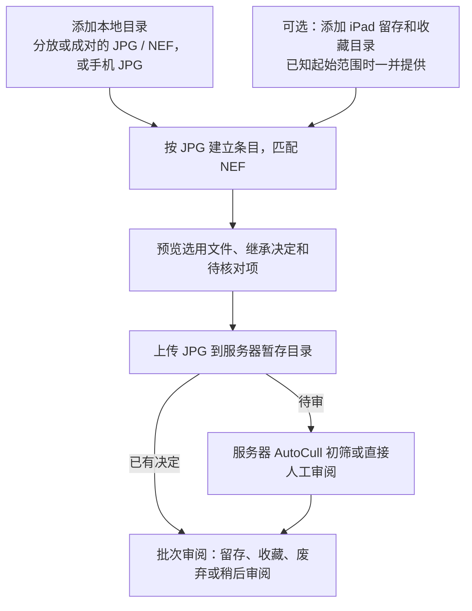
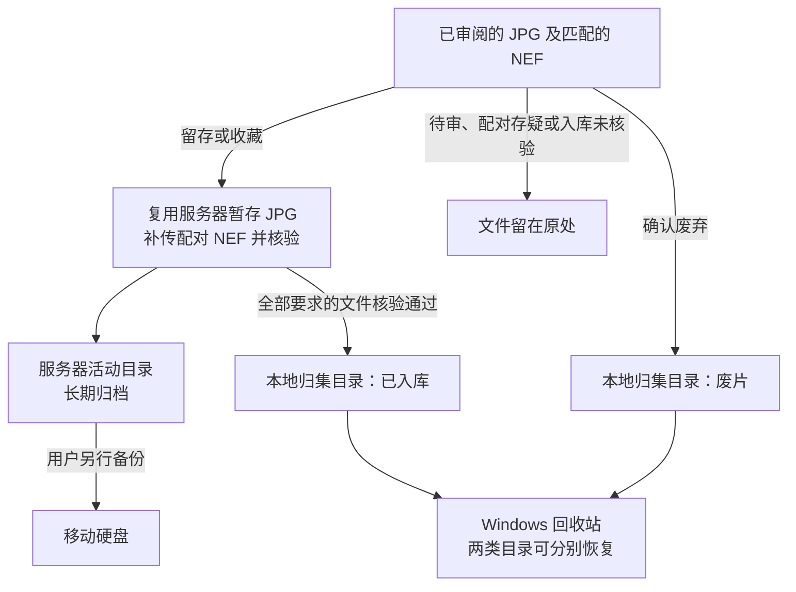
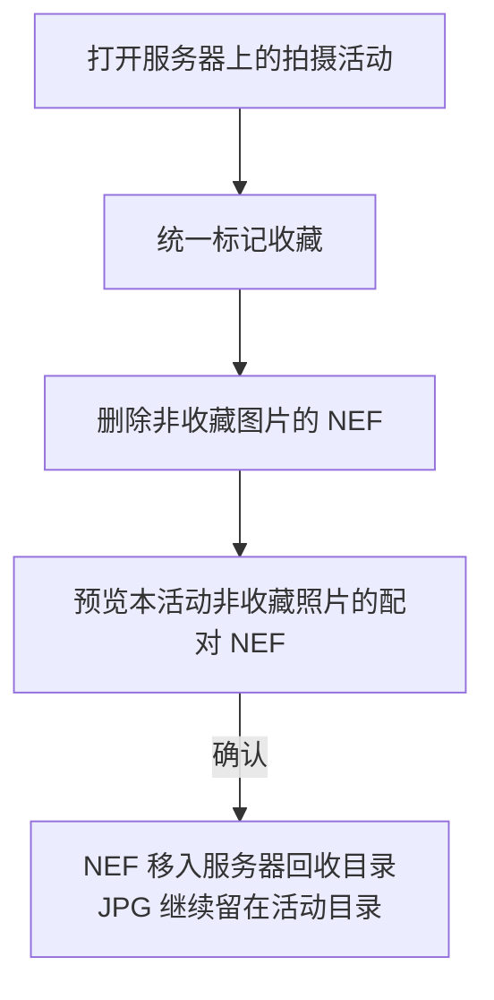
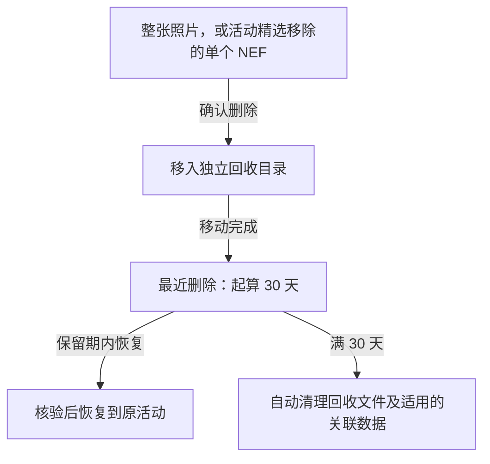

# W14 相机与 iPad 筛片入库详细设计

- 状态：已实现，待 Windows 验收
- 规划类型：简述需求规划
- 需求来源：用户对话
- 设计范围：Windows 导入、AutoCull 初筛、原片归档、活动精选与删除恢复

[现行桌面导入设计](2026-08-11-desktop-import-design.md) · [W14 实施入口](../backlog.md#w14-相机与-ipad-筛片结果汇合入库)

## 核心方案

### 1. 一个活动，一个导入页



- 电脑只有 NEF：使用 iPad 导出的 JPG，匹配独立目录里的 NEF。同一张 JPG 在两份导出中出现时合成一条，继承收藏。
- 电脑有 JPG 和 NEF：使用相机 JPG 和匹配的 NEF，iPad 导出提供审阅决定。
- 手机只有 JPG：直接选片和入库。三种来源可混在同一批次。
- iPad 收藏直接继承。匹配到 iPad 留存目录的照片，可选择直接标为留存，或继续待审。只有能证明原片对应的 JPG 曾进入 iPad，且完整导出里确实缺席，才列为待确认废弃。该规则也适用于电脑只有 NEF 的情况。
- AutoCull 只给待审 JPG 排序。人工决定废弃后才可清理。「稍后审阅」表示文件原位保留，下次继续。

### 2. 入库与本地回收



- 选源、初筛和复审期间，原片保持原路径和字节。确认提交时预览实际使用的 JPG、NEF 及服务器目标位置。
- 两类本地文件按活动和批次归集，整目录进入 Windows 回收站。回收站不可用时保留文件。只有已确认废弃的文件可以另行确认永久删除。

### 3. 活动精选与 NEF 清理



- 按活动处理，覆盖该活动的全部非收藏照片。所有 JPG 和收藏照片的 NEF 保留。
- 单独移除的 NEF 在「最近删除」中显示为「仅 NEF」，可重新关联原 JPG。

### 4. 服务器最近删除



- 整张照片删除时，JPG 和仍配对的 NEF 一起回收，照片退出日常浏览和检索。单独移除 NEF 时，JPG 继续可用。
- 回收目录位于活动目录之外，用户可按活动目录备份当前归档。

### AutoCull 接入决定

2026-11-15 确认先暂存 JPG，确认留存后补传 NEF。服务器使用固定源码提交提供的公开 CLI，分析目录使用待审 JPG 的副本，暂存原件供复审和归档。

## 补充说明 · 按需查阅

### 来源匹配与复审

- 目录选择支持电脑、SD 卡及子目录。已有 `full`、`like`、`nef` 目录可分别加入留存、收藏和本地来源。
- 匹配顺序
  - JPG 先核对内容，改名或重编码后用原名、拍摄时间及可用的相机信息核对。
  - 同目录同名优先匹配 NEF。分目录时结合拍摄范围、原名和拍摄信息。跨卡重名、多候选或证据冲突时进入「需核对」。
  - 预览显示实际文件路径、决定来源及「已配对」「仅 JPG」「需核对」。只传递审阅决定的 iPad 导出留在原位。
  - 单独的 NEF 补齐 JPG 后才能进入选片。扫描失败显示目录和原因，文件路径或盘符变动后核对内容再沿用决定。
- 审阅决定
  - 推导废弃时核对完整留存导出，并检查收藏导出中是否有匹配。覆盖未知、疑似漏匹配或收藏冲突的文件留在原处。
  - 重复导入沿用当前决定。新结果与已有人工决定冲突时逐项确认。
- AutoCull 与复审
  - 按输入清单关联 `tiers.csv` 的档位、排名、理由和连拍组。文件身份一致才复用评分。重跑或切换场景只更新建议。
  - 显示进度、失败数、取消和重试。缺模型、读取失败或无法匹配时可手工审阅，重复或冲突的结果先核对。
  - 推荐页可查看全部和低分照片，支持并排比较、快捷键及撤销。空状态显示待审数。批量留存前确认范围和张数，仅处理尚未决定的照片。
  - 默认推荐范围由真实 Nikon 旅拍样本验证。[分析入口](https://github.com/923493524/autocull/blob/6679ad3b4c1fef09980acd6704bf5a2cef3612b8/autocull/cli.py#L775-L835) · [分档字段](https://github.com/923493524/autocull/blob/6679ad3b4c1fef09980acd6704bf5a2cef3612b8/tools/deliver.py#L358-L371)

### 上传与回收的文件规则

- 客户端负责扫描、配对、批次记录和上传。Go 后端提供暂存 JPG 预览、运行初筛并管理正式入库。服务端暂存目录按批次和 JPG 摘要存储，可用于断网重试、复审和归档。[现有架构](../ARCHITECTURE.md) · [客户端上传](../../client/sync.go#L149) · [服务端上传](../../backend/internal/defaultService/service/svc_photo.go#L419)
- 入库
  - 可先提交已确认的照片。预览列出占用、缺件、重名和目标路径。同名不同内容分开落盘，配对文件共用基础名。已有副本须核对内容及归属。
  - 服务端核对临时文件的内容摘要后归档。JPG、应上传的 NEF 和库记录齐全才显示已验证。断网或摘要不符按文件反馈，重试沿用已核验文件和原照片记录。
  - 保留原始字节、修改时间及 EXIF。收藏和修正后的拍摄时间写入库记录。[现有时间修正逻辑](../../backend/internal/defaultService/service/svc_photo.go#L319-L348)
- Windows 回收
  - 每个支持回收的卷按活动及批次归集，保留来源和相对路径。记录原路径与摘要，恢复目录后可据此归位。明确选作入库原图的 iPad JPG 按同一规则处理。
  - 完成页列出服务器路径、回收结果和仅在本地的文件。回收中断后核对实际位置再继续。清空 SD 卡前，可核对仍留在卡上的待审或未入库原片。[Windows 回收站接口](https://learn.microsoft.com/en-us/windows/win32/api/shobjidl_core/nf-shobjidl_core-ifileoperation-setoperationflags#fofx_recycleondelete-0x00080000)

#### 目录示例

以下路径分别展示一次活动中留存、废弃和单独清理 NEF 的结果。

```text
选源时
D:\照片\桂林\卡1\DSC_0123.JPG + .NEF         收藏
D:\照片\桂林\卡2\DSC_0123.JPG + .NEF         留存，同名另一张
D:\照片\桂林\卡2\DSC_0124.JPG + .NEF         废弃
D:\照片\桂林\卡2\DSC_0125.JPG + .NEF         待审

完成上传及本地回收后
服务器原片/桂林/卡1前缀_DSC_0123.JPG + .NEF
服务器原片/桂林/卡2前缀_DSC_0123.JPG + .NEF
Windows 回收站/桂林-批次号-已入库/…            两对
Windows 回收站/桂林-批次号-废片/卡2/DSC_0124.JPG + .NEF
D:\照片\桂林\卡2\DSC_0125.JPG + .NEF         待审，原位

活动精选并清理服务器 NEF 后
服务器原片/桂林/卡1前缀_DSC_0123.JPG + .NEF     收藏
服务器原片/桂林/卡2前缀_DSC_0123.JPG            留存
服务器回收目录/<回收记录>/卡2前缀_DSC_0123.NEF   仅 NEF
```

### 服务器清理与恢复

- 活动清理前显示 NEF 数量、路径和到期可释放空间。执行时复核收藏、配对和文件身份，变更或存疑项跳过。
- 「最近删除」支持单张与批量恢复，按删除时间倒序，显示缩略图、原活动和剩余天数。整张照片的旧预览链接校验状态，历史引用标记已删除。
- 回收目录和归档在同一文件系统。记录原路径与逐文件进度。恢复时优先使用原路径，撞名则为配对文件分配一组新路径。核验通过后沿用照片 ID、活动、收藏、修正时间和配对。缺件时保留条目并显示具体文件。
- 整张照片与「仅 NEF」同时在回收区时，先恢复照片再恢复 NEF。超过保留期，可从仍可用的备份补传 NEF。
- 重复删除沿用原删除时间，恢复后再次删除重新计时。到期后停止接受恢复，已开始的恢复与清理互斥。
- 服务器重启后补扫到期项，部分失败按记录重试。整张删除清理原片、预览和检索索引。仅 NEF 删除只清理该文件。

### 验证依据

- W14-V1 · 同页混合三种来源。核对实际 JPG、NEF 和收藏结果，覆盖跨卡重名、留存与收藏重叠、部分导出及完整差集。
- W14-V2 · JPG 暂存后运行服务器初筛。取消、重跑及清缓存。人工决定、原片与已有 XMP 的路径和摘要一致。用 Windows 上的 Nikon 样本记录耗时和推荐覆盖。
- W14-V3 · 暂存 JPG 不进入照片库，确认后复用并补传 NEF。同名不同内容、断网、摘要不符。分别落盘，缺件可补传，重试沿用记录，核验前原片仍在本地。
- W14-V4 · 回收中断或回收站不可用。能按文件核对位置并重试，能从 Windows 分别恢复两类目录。
- W14-V5 · 跑完整批次。核对界面决定、服务器归档、本地回收和待审文件。
- W14-V6 · 修改时间及收藏后核对摘要。模拟回收中断、恢复撞名和到期清理失败，核对照片身份、配对及剩余文件。
- W14-V7 · 两个活动分别测试。只移除选定活动内未收藏且已确认配对的 NEF，跳过预览后改为收藏的照片。JPG 始终可浏览和检索，NEF 可单独恢复。

验证记录、自动回归结果与 Windows 验收步骤见 [W14](../backlog.md#w14-相机与-ipad-筛片结果汇合入库)。
