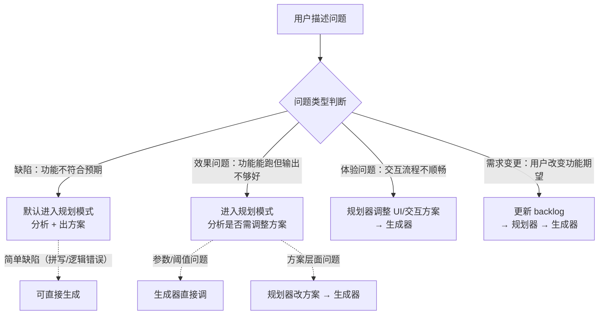

<!-- harness:begin -->
# Harness 工作总纲

本 Harness 通过规划、生成、评估完成任务，通过外环维护改进规则。模式按用户意图选择，已有授权覆盖连续流程时直接推进。

## 工作模式

- “规划一下”“帮我设计”“出个方案”等需求分析意图，读取 [规划模式](mode-planning.md)。
- “按方案执行”“开始开发”“实现这个”等实施意图，读取 [生成模式](mode-generation.md)。
- “评估”“打分”“检查质量”等审阅意图，读取 [评估模式](mode-evaluation.md)。
- “版本归档”“里程碑”“版本规划”等管理意图，读取 [项目管理模式](mode-project-management.md)。
- “完整走一遍”“全流程”“一站式”等连续执行意图，读取 [全流程模式](mode-auto.md)。

按当前意图加载对应模式原文，输入、产出、步骤和交接条件由各模式规定。

## 文档分工

- 根部 `AGENTS.md` 提供工作入口，关联顶层规则、治理规范与项目资料。
- `docs/` 优先面向开发者常用资料，承接项目自行维护的文档及持续增长的任务产物。
  - 产品行为写入 `docs/product-specs/`，Epic 与 Feature 方案写入 `docs/design-docs/`。
  - 当前模块与依赖写入 `docs/ARCHITECTURE.md`，任务状态与证据写入 `docs/backlog.md`。
  - 完成工作按[任务组织规则](../PLANS.md)归入 `docs/version/`，来源与资料写入 `docs/references/`。
- `docs/harness/` 保存相对稳定的治理原则、评估方法、输出规范和项目协作补充。
- `docs/harness/top/` 保存总纲、工作模式、规则维护与接入约定。

项目自行维护的资料按项目上下文关联，Harness 同步范围以公共治理文件为边界。需求产物按任务维护，项目人工资料按对应授权维护。

## 按需读取

先读当前模式、任务入口和直接相关产物，再按实际问题读取专项原则、局部代码与资料。入口概括用途，不要求递归展开全部链接。

涉及文档组织、拆分或维护时，读取[文档治理规范](../DOCUMENTATION.md)，适用于各工作模式。

资料类型和链接受众按[审批规则](RULES.md#文档与链接类型)判断。研究来源仅在核对依据、修订规则或任务明确需要时读取。

## 人与 Agent 的分工

协作职责与授权遵循全局 Agent 规则。
任务状态、人工验收和反馈出口分别遵循对应模式；
规则变更遵循外环审批。

## 外环改进

重复问题与用户反馈进入[外环维护](maintenance.md)，完成取证、候选、审批与效果验证。
项目复用和跨项目分发按[接入与迁移](adoption.md)处理。

## 通用协作约定

以下规则适用于所有工作模式：

- **方案选择**：同一功能存在多个会明显影响使用效果、维护成本、依赖、权限边界或任务范围的方案时，先列出重要方案及核心利弊，让用户选择。近似等价的局部实现细节可以自行决定。方案开始增加依赖、文件或模块，或依赖外部、私有实现细节时，必须停下来询问用户

## 反馈路由

当用户以非触发词描述问题时，先判断问题类型，再路由到对应模式处理。默认路由为规划模式。

> 当用户明确要求"一次性完成规划+生成+评估"或类似表述时，路由到**全流程模式**，不走上述默认路由。

---
<!-- harness:end -->
